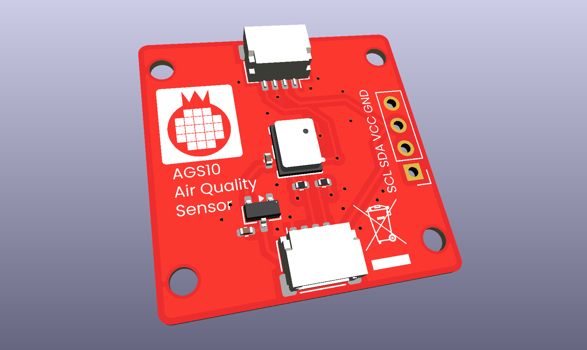
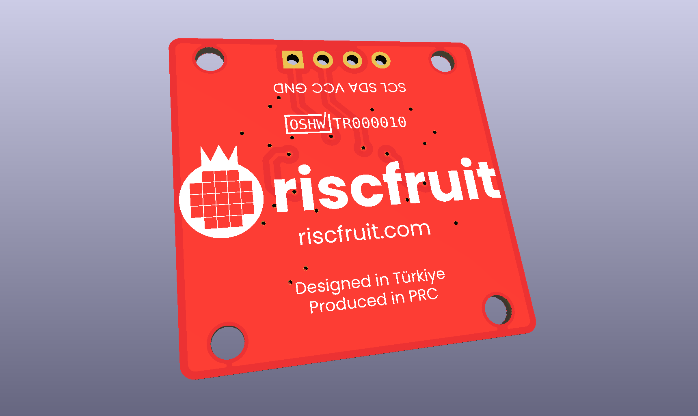

# AGS10-I2C-Sensor
Riscfruit Aosong AGS10 Air Quality I2C sensor module

### Gallery

### License
Copyright (c) 2026, Riscfruit Laboratory. This open source hardware is released under [CERN-OHL-S-2.0](LICENSE).
